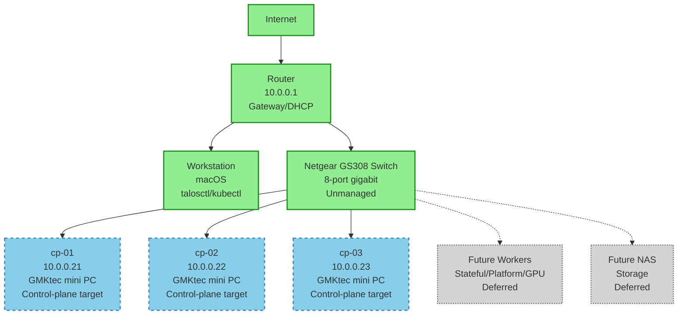

# Physical Topology

## Legend

- **Solid lines:** Current / confirmed
- **Dashed lines:** Near-term control-plane target
- **Gray, dotted lines:** Future / deferred

## Current Physical Layout

**Network:** Flat 10.0.0.0/24 (no VLANs: the GS308 is unmanaged)

## Components

### Workstation

- **Role:** Management workstation
- **OS:** macOS
- **Network:** 10.0.0.0/24 (DHCP)
- **Tools:** talosctl, kubectl, git

### Router

- **Role:** Default gateway, DHCP server (an ISP-supplied gateway)
- **IP:** 10.0.0.1
- **Management:** Web UI or SSH

### Switch

- **Model:** Netgear GS308, 8-port gigabit, unmanaged
- **Connection:** Plugged directly into a LAN port on the ISP-supplied gateway
- **Role:** Connects cp-01, cp-02 and cp-03 to the gateway on the flat network
- **Configuration:** None: it is unmanaged

### Spare Switch

- **Model:** TP-Link Omada 10-port Gigabit Smart PoE+ (exact model not verified)
- **Status:** A spare, not in the network path and not drawn above

### Control Plane Nodes

- **cp-01:** GMKtec mini PC, 10.0.0.21
- **cp-02:** GMKtec mini PC, 10.0.0.22
- **cp-03:** GMKtec mini PC, 10.0.0.23

### Future Components

- **Worker Nodes:** Stateful and stateless workers (deferred)
- **NAS:** Network-attached storage (deferred)
- **GPU Worker:** AI/ML workloads (deferred)

## Network Connections

### Current Connections

- Workstation ↔ Router (Wi-Fi)
- Router ↔ Switch (the GS308, plugged directly into a LAN port on the gateway)
- Switch ↔ cp-01, cp-02, cp-03 (cabled)

### Future Connections

- Switch ↔ Worker nodes
- Switch ↔ NAS
- Switch ↔ GPU worker

## Port Mapping

The GS308 is unmanaged, so its ports are not mapped.

## Notes

- The GS308 needs no configuration for the initial Talos bootstrap
- Current topology is flat network (no VLANs)
- VLANs are deferred ([ADR-002](../docs/adr/002-start-with-flat-network.md)) and need a managed switch: managed switching is revisited when VLAN separation is decided
- Physical connections should be labeled for clarity
